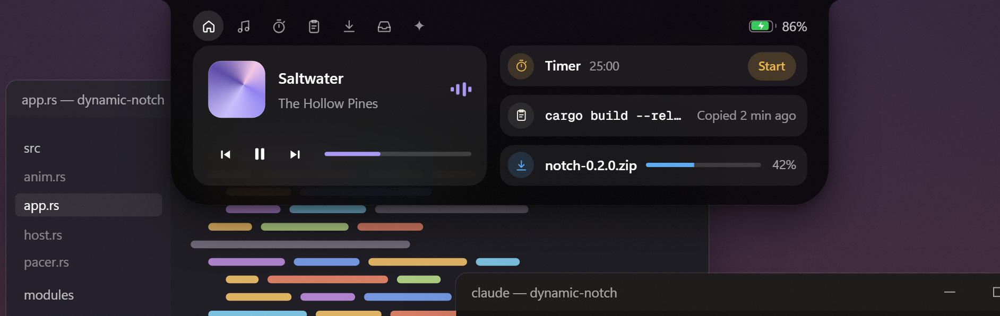
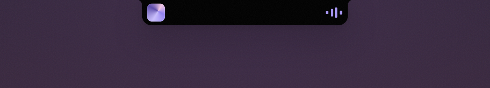
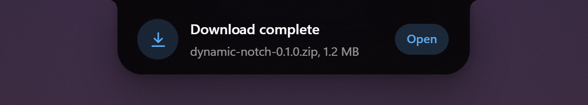
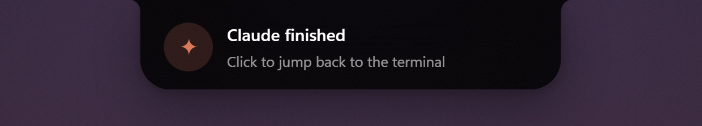

<div align="center">

# Dynamic Notch (Extended)

**A living notch for Windows, drawn in light.**

A small black island at the top of your screen for music, timers, downloads, weather, dictation and AI.
Everything on it speaks in one language: thin blue **beams** that fill, drain and sweep as things change.
It grows when something happens and quietly gets out of the way when nothing does.




</div>

<table>
  <tr>
    <td></td>
    <td></td>
    <td></td>
  </tr>
  <tr>
    <td align="center"><sub>Live activities</sub></td>
    <td align="center"><sub>Peeks</sub></td>
    <td align="center"><sub>Claude Code hook</sub></td>
  </tr>
</table>

Dynamic Notch pairs a flat, black glass design with a Settings tab, a customizable home page, Weather, a combined Wi-Fi and Bluetooth Control Center, Windows notifications, a Gemini chat tab, Notes, a Face ID style unlock animation and one unified light language. See the [changelog](CHANGELOG.md) for the full list.

## Contents

- [Beams: the light language](#beams-the-light-language)
- [What's new in this build](#whats-new-in-this-build)
- [How it works](#how-it-works)
- [Modules](#modules)
- [Getting started](#getting-started)
- [Hotkeys](#hotkeys)
- [Configuration](#configuration)
- [API keys](#api-keys)
- [Command line](#command-line)
- [Claude Code hook](#claude-code-hook)
- [Performance](#performance)
- [Privacy](#privacy)
- [Project layout](#project-layout)
- [Writing a module](#writing-a-module)
- [Troubleshooting](#troubleshooting)
- [License](#license)

## Beams: the light language

Every piece of information in the notch is shown with **beams**: thin, rounded, vertical bars in a single electric blue. A beam is either lit or dim, so a row of them reads as a gauge at a glance, and because they are the same everywhere you learn them once and understand the whole app.

| Shape | What it looks like | Where you see it |
| --- | --- | --- |
| **Beam bar** | A horizontal row that fills from left to right | Volume and brightness, battery, Caps/Num/Scroll Lock, storage, context use in Gemini, history fullness in Clipboard |
| **Beam ring** | Beams arranged around a circle that fill clockwise | Timer countdown, system stats (CPU, memory, graphics), the unlock animation |
| **Beam sweep** | A bright stretch that glides along the row | Anything that is busy: Gemini answering, Wi-Fi and Bluetooth scanning or connecting, loading states |
| **Beam rail** | A row along the bottom of a peek that drains while it is on screen | Every notification, media, download, clipboard and device peek |
| **Beam graph** | Bars whose heights follow a set of values | Short histories and trends |
| **Beam rule** | A faint row that separates sections | Between widgets on the closed notch, between conversation turns in Gemini |

How they behave:

- **Always blue.** Lit beams use the app's blue with a lighter leading edge. Dim beams are a quiet white.
- **Always smooth.** Values glide to their new level instead of jumping, so a changing number never snaps.
- **Only when needed.** Beams are drawn by the app only while something is moving, so they cost nothing while the notch is at rest.

Where they show up:

- **Volume and brightness**: the on-screen display is an icon, a percentage and a long beam bar.
- **Peeks**: a rail of beams drains while a peek is visible, so you can see how long is left.
- **Closed notch**: widgets are separated by a single beam, and the battery is a small beam gauge.
- **Media**: the scrubber and the visualizer.
- **Clipboard**: each row shows how fresh the copy is, and the card shows how full the history is.
- **Gemini**: a header with a context meter, a rail that sweeps while it answers, and beam rules between turns.
- **Wi-Fi and Bluetooth**: signal strength per network, connected-device count, and a sweep while scanning.
- **System stats**: three large beam rings with values that glide.
- **Unlock**: a ring of beams fills around a smiley face, which turns into a check mark.

## What's new in this build

- **Settings tab** with a GUI for general options, look (glass, opacity, size, bounce, speed, accent), home widgets, module switches, weather, tab order and your Gemini key.
- **Customizable home page**: pick up to four widgets and reorder them with the ‹ › arrows. The clock stays on the left.
- **Weather** tab and widget, powered by Open-Meteo (no key needed).
- **Control Center**: Wi-Fi and Bluetooth in one tab, with two buttons that slide between the lists.
- **Notifications**: Windows notifications appear in the notch, with a short history.
- **Gemini** chat tab with in-app key entry and a flat, beam-accented conversation that matches the rest of the panel.
- **Mirror** tab: a small live camera preview that only runs after you press the Mirror button.
- **Notes** tab and widget for quick snippets you can copy back with one click.
- **Spinning vinyl** on the media player when a track has no artwork.
- **Face ID style unlock**: when you unlock your PC the notch grows into a small square, a ring of blue beams fills around a smiley face, and a check mark confirms it before the notch tucks away.
- **Smooth tab changes**: pages slide and cross-fade softly in the direction of the tab, in about half a second.
- **Unlock greeting**: set `[greeting] name` to also get a hello with the date.
- **System stats page** with three large rings for CPU, memory and graphics.
- **One light language**: every gauge, ring, loader and countdown is built from blue beams (see above).
- **New look**: black glass, rounder corners, hairline-bordered tiles, thin sliders, green switches, and thin rounded vector icons. Uses Inter when installed and falls back to Segoe UI Variable.
- **USB drive peek**: a short notice when a drive is connected or removed.
- **Tab order is yours**: reorder the header tabs in Settings → Tabs, or scroll the mouse wheel over the header to flip through them.

## How it works

The notch has four sizes and moves between them with spring physics.

1. **Rests.** A 188 × 32 px notch at the top of your monitor. Hover it and it leans toward your cursor. It hides for fullscreen games, videos and presentations.
2. **Lives.** When music plays or a timer runs, the notch widens just enough to show it: album art and a visualizer, or a countdown ring.
3. **Peeks.** Events slide out for about three seconds: a finished download, a plugged-in charger, Caps Lock, a new track. Click a peek to open what it is about.
4. **Opens.** Hover, click or press <kbd>Ctrl</kbd>+<kbd>Alt</kbd>+<kbd>N</kbd> for the full panel on frosted glass. It closes as soon as your mouse leaves.

## Modules

Each module is a single Rust file that sleeps until Windows tells it something changed. Switch any of them off from the tray menu, the Settings tab, or `config.toml`.

| Module | What it does | Built on |
| --- | --- | --- |
| **Media** | Artwork, title and controls for whatever is playing, with a visualizer tinted from the album art. | System Media Transport Controls |
| **Timer** | Timers and a stopwatch with a countdown ring and a chime. | Wakes only while running |
| **Downloads** | Browser downloads with size and speed, plus a peek when they finish. | `ReadDirectoryChangesW` |
| **Clipboard** | Recent copies: text, links, files and images. Click one to copy it again. | Memory only, skips password managers |
| **Shelf** | Drop files on the notch to park them, then drag them out later. | OLE drag and drop |
| **Dictation** | Hold <kbd>Ctrl</kbd>+<kbd>Alt</kbd>+<kbd>D</kbd> and speak. The text is typed into the app you were using. | WASAPI capture, Whisper on Groq |
| **Ask AI** | A quick prompt with streamed answers and follow-ups. | OpenRouter, any model |
| **Gemini** | A dedicated chat tab for Google Gemini. | Gemini API, streamed |
| **Weather** | Current conditions and a five-day forecast for your city. | open-meteo.com |
| **Control Center** | Wi-Fi and Bluetooth in one tab: scan, connect, pair, disconnect and switch the radios. | `Windows.Devices.WiFi`, Bluetooth APIs |
| **Mirror** | A small camera preview on its own tab. The camera is off until you press the round Mirror button, and it switches off again when you close it, leave the tab or close the notch. | Windows `MediaCapture` |
| **Bluetooth** | Connect and disconnect peeks with device battery level and a low-battery warning. | `DeviceWatcher`, GATT Battery Service |
| **Notifications** | Windows notifications in the notch, with a short history. | `UserNotificationListener` |
| **System Stats** | CPU, RAM and GPU load, sampled only while the notch is open. | `GetSystemTimes`, PDH GPU counters |
| **Mic & Camera** | A dot whenever an app uses your microphone or camera, and a peek naming it. | Capability consent store |
| **Dev Servers** | Local servers on localhost as they start, each with an Open button. | TCP listener table |
| **Lock Keys** | A short peek when Caps Lock, Num Lock or Scroll Lock changes. | Raw keyboard input |
| **Battery** | Level and charging state, with peeks for plugged in, unplugged, low and full. | `WM_POWERBROADCAST` |
| **Volume & Brightness** | Replaces the Windows volume flyout with a notch peek. | `IAudioEndpointVolume`, WMI |
| **Devices** | A peek when a USB drive is connected or removed. | `WM_DEVICECHANGE` |
| **Notes** | Short notes stored in a plain text file. | `notes.txt` in the settings folder |
| **Unlock greeting** | A short hello with the date when you unlock the PC. | Session notifications |
| **Settings** | A GUI for the common options, home widgets and modules. | Writes `config.toml` |
| **Claude Code** | Tells you when Claude finishes or needs you. | Stop and Notification hooks |

## Getting started

### Requirements

- Windows 10 version 1903 or later (Windows 11 is recommended for the frosted glass)
- [Rust](https://rustup.rs) (stable) and the MSVC build tools (Visual Studio Build Tools with "Desktop development with C++")

### Build and run

```powershell
cargo build --release
.\target\release\dynamic-notch.exe
```

There is no installer and no runtime to install. Right-click the notch or the tray icon to pick modules and a monitor, and to turn on **Start with Windows**.

Debug builds keep a console window open for log output. To build for the other architecture, add its target first:

```powershell
rustup target add aarch64-pc-windows-msvc   # or x86_64-pc-windows-msvc
cargo build --release --target aarch64-pc-windows-msvc
```

### Updating

Quit the notch from the tray and replace the exe. Your settings live in `%APPDATA%\DynamicNotch` and are kept.

### Before opening a pull request

```powershell
cargo fmt --check
cargo clippy --all-targets -- -D warnings
cargo test
```

## Hotkeys

| Shortcut | Action |
| --- | --- |
| <kbd>Ctrl</kbd>+<kbd>Alt</kbd>+<kbd>N</kbd> | Open or close the notch |
| <kbd>Ctrl</kbd>+<kbd>Alt</kbd>+<kbd>Space</kbd> | Ask AI |
| <kbd>Ctrl</kbd>+<kbd>Alt</kbd>+<kbd>D</kbd> | Dictate: tap to start and stop, or hold to talk |
| <kbd>Ctrl</kbd>+<kbd>Alt</kbd>+<kbd>T</kbd> | Timer |
| <kbd>Ctrl</kbd>+<kbd>Alt</kbd>+<kbd>V</kbd> | Clipboard history |
| Volume keys | Volume peek instead of the Windows flyout |
| Mouse wheel over the header | Flip through the tabs |

Every shortcut can be changed or turned off in the `[hotkeys]` section of the config. Play/pause has no default shortcut.

## Configuration

Settings live in `%APPDATA%\DynamicNotch\config.toml`, which is created with comments on first start. Changes apply as soon as you save the file, and most of them can also be made in the **Settings** tab (the gear icon) without editing anything by hand. Open the file from the tray with **Edit settings…**.

```toml
[general]
monitor = "primary"        # "primary", "active" (follow the focused window) or 1, 2, ...
expand_on_hover = true
idle_style = "notch"       # "notch", "pill" (slim line when idle) or "hidden"
hide_in_fullscreen = true

[appearance]
expanded_width = 720
expanded_opacity = 0.92    # lower = more glass
blur = true
bounce = 0.3               # 0 = no overshoot ... 1 = very bouncy
accent = "auto"            # from the album art, or "#RRGGBB"
scale = 1.0

[hotkeys]
toggle = "Ctrl+Alt+N"
ai = "Ctrl+Alt+Space"
dictate = "Ctrl+Alt+D"

[modules]
bluetooth = true           # every module can be switched off here
mirror = true              # the camera tab (the camera itself only runs on demand)

[home]
widgets = ["weather", "stats", "timer", "control"]   # up to 4

[notch]
widgets = ["clock", "battery"]   # up to 3 small widgets on the closed notch

[tabs]
order = ["media", "timer"]       # Home always comes first

[weather]
city = "Berlin"
units = "metric"           # or "imperial"

[ai]
model = "google/gemini-3.1-flash-lite"   # any OpenRouter model id

[gemini]
model = "gemini-2.5-flash"

[greeting]
name = ""                  # empty = your Windows user name
```

Every key is optional. A missing or invalid value falls back to its default, and [`src/config.rs`](src/config.rs) documents each option.

**Home widget ids:** `weather`, `stats`, `timer`, `control`, `notes`, `clipboard`, `downloads`, `shelf`, `ports`.
**Closed-notch widget ids:** `clock`, `date`, `battery`, `weather`, `wifi`, `bluetooth`, `notes`.

## API keys

Everything works without a key except the AI features. Keys are read from the environment or a `.env` file and are never written to `config.toml` or the log.

```ini
# Ask AI: https://openrouter.ai/keys
OPENROUTER_API_KEY=sk-or-...
# Dictation: https://console.groq.com/keys
GROQ_API_KEY=gsk_...
# Gemini tab: https://aistudio.google.com/apikey
GEMINI_API_KEY=...
```

Copy `.env.example` to `.env` and fill in what you need. For Gemini you can also paste the key straight into the Gemini tab or Settings → Gemini; it is then saved to `%APPDATA%\DynamicNotch\.env`.

The notch looks for `.env` in this order:

1. the process environment
2. next to `dynamic-notch.exe`, then up to three parent folders
3. the current working directory
4. `%APPDATA%\DynamicNotch\.env`

## Command line

Run the exe again while the notch is running and it hands the command to the running instance, which makes it easy to script.

```powershell
dynamic-notch notify "Build finished" "All 112 tests passed"
dynamic-notch progress "Rendering" 42          # 0-100, then "done" or "cancel"
dynamic-notch timer 25                          # start a 25 minute timer
dynamic-notch ask "convert 72F to C"            # ask the AI
dynamic-notch expand timer                      # open the notch on a tab
dynamic-notch toggle | expand | collapse | ai | reload | quit
```

Run `dynamic-notch --help` for the full list.

## Claude Code hook

Add `dynamic-notch claude` as a `Stop` and `Notification` hook in `~/.claude/settings.json`. The exe needs to be on your `PATH`, or use its full path.

```json
{
  "hooks": {
    "Stop": [{ "hooks": [{ "type": "command", "command": "dynamic-notch claude" }] }],
    "Notification": [{ "hooks": [{ "type": "command", "command": "dynamic-notch claude" }] }]
  }
}
```

It stays quiet while you are looking at the terminal Claude runs in, and peeks when you are not. Clicking the peek brings that terminal to the front. Add `--always` to peek even when the terminal is focused. The hook never starts the notch, so it returns immediately when the notch is not running.

## Performance

The app talks directly to the Windows compositor. Nothing is drawn unless something changes, and the music visualizer is animated by the compositor itself, so playback costs no CPU either. Sampling for system stats happens only while the notch is open, and beams animate only while a value is changing, so an idle notch uses essentially no CPU.

## Privacy

- No telemetry, no accounts, no update checks.
- Clipboard history is kept in memory only and cleared when you quit. Content that password managers mark as sensitive is never read.
- Data leaves your PC only when you use an online feature: AI prompts go to OpenRouter or Gemini, dictation recordings go to Groq, and weather lookups go to Open-Meteo.
- API keys are never written to the config or the log.

## Project layout

```
src/
  main.rs        entry point, single instance, command-line forwarding
  app.rs         notch state machine: modes, peeks, pages, hit testing
  host.rs        Windows.UI.Composition visual tree and backdrop blur
  window.rs      Win32 window plumbing and message loop
  anim.rs        spring animations
  pacer.rs       frame pacing: draw only while something moves
  gfx/           Direct2D / DirectWrite drawing, icons, images
  modules/       one file per module
  sys/           Windows helpers: audio, clipboard, drag and drop, HTTP, speech to text
  config.rs      config.toml, defaults and hot reload
  claude.rs      Claude Code hook bridge
site/            the project website
docs/images/     screenshots used in this README
```

## Writing a module

A module implements the `Module` trait in [`src/modules/mod.rs`](src/modules/mod.rs) and is added to `modules::all()`. It runs on the UI thread, receives messages from its own worker threads through the `Bus`, and can contribute any of:

- a live activity in the collapsed notch
- status indicators in the header
- peeks
- a card on the home page
- its own tab

Give it a switch in `[modules]` in [`src/config.rs`](src/config.rs) so it can be turned off.

## Troubleshooting

- **The notch doesn't appear.** It hides while a fullscreen app is in front, and with `idle_style = "hidden"` it only shows on activity. Check the tray menu, as **Hide notch** may be on.
- **Ask AI, Gemini or dictation says the key is missing.** Add the key to a `.env` file in one of the [places listed above](#api-keys), or paste it into the Gemini tab. The file is read on every request, so no restart is needed.
- **The Mirror stays black or says it can't open the camera.** Allow desktop apps to use the camera under Windows Settings → Privacy & security → Camera, and close other apps that hold it exclusively.
- **Windows notifications don't show up.** The Notifications module needs notification access, which you can allow under Windows Settings → Privacy & security → Notifications. The Notifications tab shows what Windows answered.
- **Something else.** The log is at `%APPDATA%\DynamicNotch\notch.log`. Please check it for anything private before sharing it.

## License

Copyright (c) 2026 <YOUR NAME>. All rights reserved for the additions made in this build; the portions derived from earlier work remain under the notice kept in [LICENSE](LICENSE). Please read that file before copying, sharing or reusing any part of this project.
