# Dynamic Notch

A small black notch at the top of your Windows screen that grows into a control panel when you need it, and gets out of the way when you don't.

It shows what is playing, what your PC is doing and what needs your attention, and it puts a dozen everyday tools one hover away: clipboard, timer, notes, weather, AI chat, a camera mirror and more. Everything is drawn in one style: flat black glass, thin icons, and rows of tiny glowing bars we call **beams**.

Written in Rust. No browser engine, no runtime to install, one `.exe`.

<p align="center">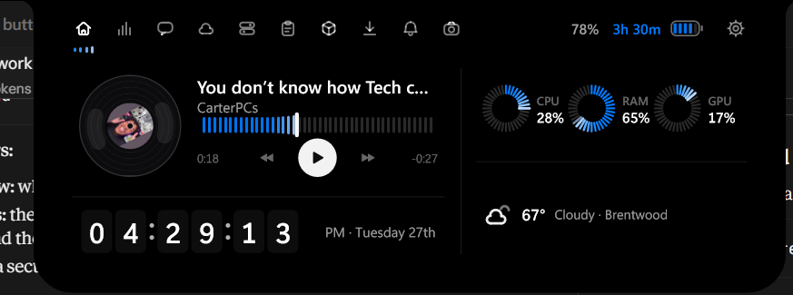</p>

---

## At a glance

| | |
|---|---|
| **Look** | Black glass, soft corners, hairline dividers, blue beams that shine white at their leading edge |
| **Motion** | Spring-driven open and close, staged so the shape moves first and the content follows |
| **Size** | One small executable, no installer, no background services |
| **Settings** | A built-in settings tab, plus a plain-text config file for everything else |
| **Platform** | Windows 10 and 11 |

---

## What is inside

### The home page

- A **rolling-digit clock** with seconds (or a flip clock, your choice), with AM/PM beside it.
- A **calendar strip** under the time. Scroll the mouse wheel over it, or click a day, to look through other dates. The chosen day is blue and a lit beam glides along a rail beneath it. Click the month to jump back to today.
- **Up to four widgets** you pick yourself: system stats, weather, battery, devices and more.
- When music plays, the player takes the left side and the clock tucks into a slim strip underneath.

### The tabs

| Tab | What it does |
|---|---|
| **Media** | Now playing for any app that reports to Windows. A spinning record with the cover as its label, a beam scrubber, a live visualizer |
| **System stats** | Three beam rings for CPU, memory and graphics |
| **Timer** | Countdown and stopwatch with quick presets; the notch shows the time left while it runs |
| **Clipboard** | History of what you copied, newest first, with a beam showing how fresh each entry is |
| **Notes** | Small snippets you can copy back with one click |
| **Shelf** | Drop files on the notch to park them, drag them out when you need them |
| **Downloads** | Watches your Downloads folder and shows what just arrived |
| **Weather** | Current conditions and a short forecast, no account or key needed |
| **Wi-Fi and Bluetooth** | Networks and paired devices in one place, with signal beams and device batteries |
| **Notifications** | Windows notifications appear in the notch, with a short history |
| **Dev servers** | Lists what is listening on localhost, with page titles, so you can open or copy a link |
| **Dictation** | Hold a hotkey, speak, release; the text is pasted into the app you were typing in |
| **Ask AI / Gemini** | Chat panels for quick questions, with your own API key |
| **Mirror** | Press the round button to see yourself in the camera. It only runs while you ask for it |
| **Settings** | Everything below |

A few of the tabs:

<p align="center">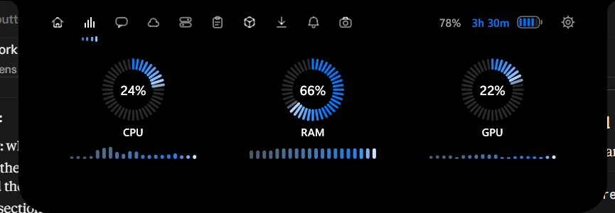</p>
<p align="center">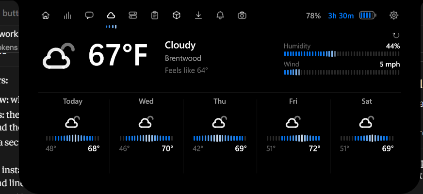</p>
<p align="center">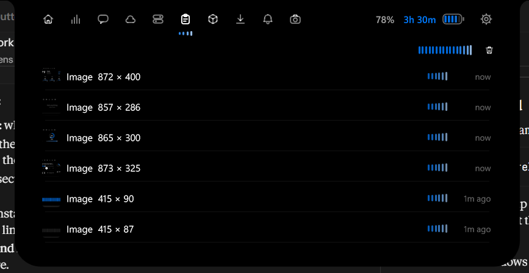</p>
<p align="center">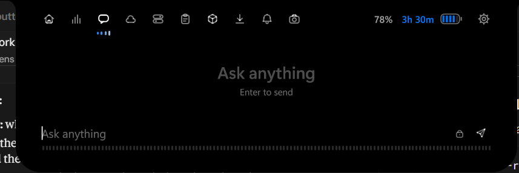</p>
<p align="center">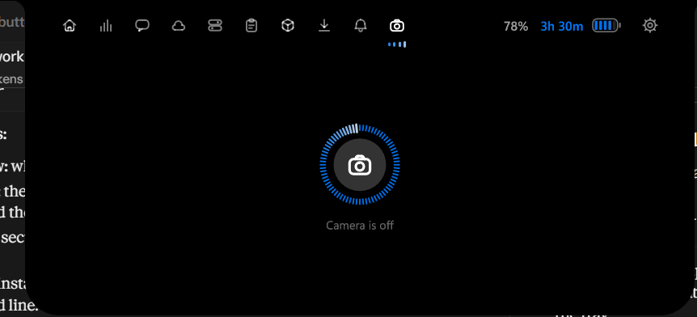</p>

### Peeks and indicators

<p align="center">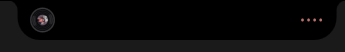</p>

Small, short-lived messages that slide out of the closed notch and drain away on their own:

- volume and brightness, drawn as a long beam bar (rest the pointer on the speaker to switch output device)
- caps lock and num lock
- a USB drive connected or removed
- a new track, a finished timer, a finished download
- a microphone or camera in use
- the **unlock greeting**: when you unlock your PC, a ring of beams fills, a check mark confirms, then "hello" is written in handwriting, with your name if you set one

<p align="center">
  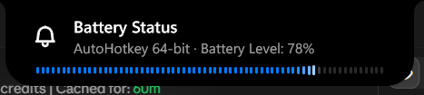
  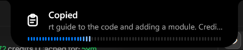
</p>
<p align="center">
  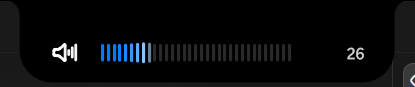
  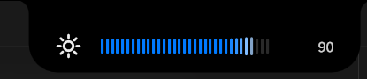
</p>

---

## Looks

Settings → Appearance → **Look** has four choices:

- **Beams** (default): rows of small glowing bars carry every level, progress and signal: volume and brightness, the media scrubber, system stats, signal strength, battery gauges, downloads, the timer and more.
- **Calm**: beams stay only on the volume and brightness bars and the battery gauges. Everything else is one of three quieter looks: a **glow bar** whose lit end turns white and swells gradually (progress, sliders, ranges, shimmers), **pill segments** (small meters and graphs) and a **dot ring** (every circular gauge).
- **Minimal**: no glow and no swell. Gauges are thin plain lines, rings are hairline arcs, "working on it" is one short line gliding along its rail, and the scrubber shows a small dot only when you hover it. Motion has no bounce at all, so everything arrives and settles quietly.

- **Nothing**: inspired by Nothing OS. Everything is white on black with a single red accent, drawn as dot-matrix "glyph" lights. Gauges are rows of LED dots with a red leading dot, "working on it" is a little comet of dots stepping along, rings are circles of dots, graphs are columns of dots, the tab marker is one red dot, and the home clock is a 5x7 dot-matrix display with a red colon. Motion is crisp, mechanical and bounce-free.
- **Bloom**: soft and rounded, in the spirit of the Bloom AI app. Gauges are thick capsules on a faint track, rings are thick with round ends, graphs are rounded bars, the scrubber is a capsule with a round knob that appears on hover, and lists and cards sit in bordered, translucent groups. The accent is a clear iOS blue, and motion is a smooth ease-out with hardly any overshoot. Everything else (Gemini, clipboard, shelf, ports and the rest) picks the look up automatically.

Every feature is available in all four. The look changes as soon as you press it.

How beams behave:

- Lit beams are blue; unlit ones are a quiet grey.
- The beams at the leading edge shine white, and **the whiter a beam is, the larger it is**.
- Values glide to their new level instead of jumping.
- Beams are only redrawn while something is moving, so a resting notch costs next to nothing.
- Prefer white beams? There is a switch for that in Settings.

---

## Install and update

**Installer (easiest).** Download `DynamicNotch-Setup.exe` from the Releases page and run it. It installs for your user only, so there is no administrator prompt, and it adds a Start menu shortcut and an uninstaller. It installs no service and no scheduled task: whether the notch starts with Windows is a setting inside the app.

**Portable.** The release zip holds a single `dynamic-notch.exe`. Unzip it anywhere and run it.

**The dock.** Switch it on under Settings → Dock. It sits at the bottom of the screen with your pinned apps and every app that is running: icons grow near the pointer, a bar under the icon shows what is open (a long one for the focused window), resting the pointer on an app shows live previews of its windows (click one to switch, the small cross closes it), click an icon to open, focus or minimize, scroll over it to step through windows, right-click to pin, unpin or close, and drag icons to reorder. "Hide the Windows taskbar" makes it a full taskbar replacement: maximized windows stop above the dock, and the taskbar comes back when you switch it off, quit, or start the app again after a crash. The dock hides itself while a full-screen app is in front. `[dock]` in the config.

**Updating.** Open Settings → General → Updates and press **Check for updates**. The app asks GitHub for the newest release once, then stops. If there is a newer one, press **Install**: it downloads the installer, runs it quietly, and the notch restarts on the new version. Nothing is ever checked in the background or at start-up. The repository it looks at is `[update] repo` in the config.

**Build it yourself.** You need Windows and the Rust toolchain:

```
cargo build --release
```

The program ends up in `target\release\dynamic-notch.exe`. To build for Windows from another system:

```
cargo build --release --target x86_64-pc-windows-gnu
```

To make the installer yourself, install [Inno Setup 6](https://jrsoftware.org/isinfo.php) and compile `installer/DynamicNotch.iss`. Pushing a release tag such as `v3` builds the zips and the installer on GitHub automatically.

---

## Using it

**Mouse**

- Hover over the notch (or click it) to open it. Hover opening can be turned off in the config.
- Click a header icon to change tab. Scroll the wheel over the header to flip through tabs.
- Right-click the notch or the tray icon for the menu.

**Keyboard** (all of these can be changed)

| Keys | Action |
|---|---|
| `Ctrl+Alt+N` | Open or close the notch |
| `Ctrl+Alt+Space` | Ask AI |
| `Ctrl+Alt+T` | Timer |
| `Ctrl+Alt+V` | Clipboard |
| `Ctrl+Alt+D` | Dictation (tap to start and stop, or hold to talk) |

**Command line**

A second launch talks to the copy that is already running:

```
dynamic-notch toggle | expand | collapse | ai | reload | quit
```

---

## Settings

Open the gear in the header. The tabs cover:

- **General**: where the notch sits, which screen, what it does when idle, the unlock greeting, the name it says hello to, the hello font, a few handy buttons (edit the config file, open the data folder), and the **Updates** button.
- **Look**: glass, opacity, sizes, bounce, speed, accent colour, beam style, the home clock style, and a switch for lighter animations.
- **Home**: choose and order the home widgets.
- **Modules**: switch whole features on or off. A feature that is off does not run at all.
- **Weather**: your city and units.
- **Tabs**: reorder the header tabs.
- **Gemini**: paste your key.

Changes apply straight away.

---

## Config and keys

Everything lives in `%APPDATA%\DynamicNotch\`:

| File | Purpose |
|---|---|
| `config.toml` | Every option, commented. Edit it any time |
| `.env` | API keys, kept apart from the config so you can share your settings safely |

Keys the app understands:

| Key | Used by |
|---|---|
| `GEMINI_API_KEY` | Gemini chat |
| `OPENROUTER_API_KEY` | Ask AI |
| `GROQ_API_KEY` | Dictation |

You can paste the Gemini key straight into the app; the others go in `.env`.

---

## Privacy

- The camera and microphone are off until you ask. The Mirror closes itself when you leave its tab or close the notch.
- Nothing goes online unless you use a feature that needs the internet (weather, AI, dictation) and have given it a key where one is needed.
- Clipboard history, notes and the shelf stay on your PC.
- API keys are stored in `.env`, never in `config.toml`.

---

## Built to stay light

- Drawn directly with Direct2D and DirectWrite. There is no web view.
- The notch only redraws when something changes. Ambient effects (shimmers, sweeps) run at your screen's refresh rate up to 60 fps, and nothing is drawn while everything is still.
- Opening, closing and page slides draw the finished content once as a picture and just move it, which keeps those moments cheap. This can be turned off in Settings.
- Text layouts, images and shapes are cached with size limits, and idle memory is trimmed after the notch has been quiet for a while.
- Background workers (stats, dev servers, notifications) slow down or stop when nobody is looking at them.

---

## For developers

```
src/
  main.rs, window.rs, host.rs   the window and the compositor surface
  app.rs                        the notch itself: layout, springs, drawing
  anim.rs, pacer.rs             springs and frame pacing
  gfx/                          Direct2D / DirectWrite painter and icons
  ui.rs                         buttons, beams, clocks and other widgets
  config.rs                     settings and the default config template
  modules/                      one file per feature
  sys/                          Windows helpers (audio, clipboard, HTTP, speech)
```

**Adding a feature** means adding a file in `src/modules/` that implements the `Module` trait: an id, a title, an icon, and what to draw. A module can have a page, a home widget, a peek, or an indicator on the closed notch, and it receives system events and messages from background threads through a small message bus. Register it in `modules/mod.rs`, add its switch to the config, and it shows up in the header.

Run the tests with `cargo test`.

---

## Credits and licence

Built on the open-source DynamicNotch project by eigenes (MIT), with a new look, many new modules and a lot of polish on top. See `LICENSE`.
